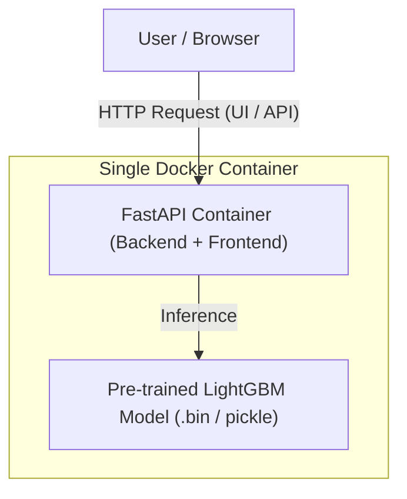

# HeadHunter Resume Salary & Career Analytics (ML Zoomcamp Capstone Project)

[](https://www.python.org/)
[](https://fastapi.tiangolo.com)
[](https://lightgbm.readthedocs.io/)
[](https://www.docker.com/)
[](https://cloud.ru/)

End-to-end Machine Learning web application that predicts expected salary expectations based on applicant profiles (age, gender, education, experience, city, and desired job) extracted from HeadHunter resume datasets.

The application integrates a **FastAPI backend and frontend interface into a single container** and runs in a Managed Kubernetes cluster provisioned via Terraform.

Built as a capstone project for the **[DataTalks.Club Machine Learning Zoomcamp](https://github.com/DataTalksClub/machine-learning-zoomcamp)**.

---

## Problem Description

Job seekers frequently publish resumes without specifying a desired salary due to various reasons (fluctuating market conditions, uncertainty about their competitive value, or a desire to avoid filtering out prematurely). Similarly, recruiters often struggle to benchmark expected compensation accurately against market realities.

**The Solution:**
This project provides an automated machine learning prediction service designed to bridge this gap for both applicants and employers:
1. **Smart Salary Recommendation**: Predicts a realistic, market-aligned recommended salary based on the candidate's core parameters (desired position, professional experience, location, education, age, and gender).
2. **Market Salary Range**: Calculates a dynamic salary range (min/max bounds) derived from historical dataset distributions for matching input profiles, making salary negotiations transparent and data-driven.
3. **Automated ML Pipeline**: Cleans raw data, handles multi-currency conversion to RUB, filters outliers via quantile clipping, and trains high-performance **LightGBM** gradient boosting models using native categorical feature support.
4. **Production Web Service**: Serves predictions through an intuitive web interface and REST API powered by **FastAPI**.
5. **Cloud Deployment**: Fully containerized and deployed to a Managed Kubernetes cluster in Cloud.ru.

---

## System Architecture



## Tech Stack & Tools

- **Machine Learning**: LightGBM, XGBoost, Scikit-Learn, Pandas, NumPy.
- **Backend & Frontend**: FastAPI, Uvicorn, HTML/CSS (Single-page interface).
- **Containerization**: Docker (multi-stage builds with pre-baked model artifacts and OpenMP support).
- **Infrastructure as Code**: Terraform (Cloud.ru Evolution Managed Kubernetes).
- **Deployment**: Kubernetes (`kubectl`).

---

## Repository Structure

```
.
├── app/
│   └── main.py              # FastAPI application & endpoints (/predict, /health)
├── data/                    # Raw datasets (HH database and exchange rates)
├── notebooks/               # Jupyter notebook with EDA, data prep, and model tuning
├── k8s/                     # Kubernetes manifests (Deployment, Service, etc.)
├── tf/                      # Terraform infrastructure code for Cloud.ru
├── png/                     # Documentation and UI screenshots
├── Dockerfile               # Single-container build recipe for Backend + UI + Model
├── pyproject.toml / uv.lock # Dependency management configuration (uv)
├── index.html               # Frontend HTML UI interface
├── model.bin                # Pre-trained LightGBM model artifact
├── train.py                 # Script for training and saving the model
└── train_lgbm.py            # Specialized training script for LightGBM
```

---

## Quickstart & Setup Guide

### Prerequisites
- Python 3.12 & `uv` or `pip`
- Docker installed locally
- Kubernetes CLI (`kubectl`) configured (if deploying locally or to cloud)

### 1. Clone the repository:
```bash
git clone https://github.com/petr-akimov/hh-salary-advisor.git
cd hh-salary-advisor
```

---

### 2. Install Dependencies:

```
uv sync
```

--- 

### 3. Run Training Script (Generates Model Artifact):

```
python train_lgbm.py
```

### 4. Run the Application Locally via Docker:

```
docker build -t hh:latest .
docker run -it -p 8000:8000 hh:latest
```

Open your browser at http://localhost:8000 to interact with the web interface.

---

## Infrastructure Provisioning (Terraform)

To provision a Managed Kubernetes cluster in **Cloud.ru Evolution** using Terraform:

1. Navigate to the `tf/` directory:
   ```bash
   cd tf
   terraform init
   terraform validate
   terraform plan
   terraform apply
   ```

---

## Kubernetes cluster and application status

 <br>

---

## User Interface & Estimated Salaries

 <br>

 <br>

 <br>

---


## Evaluation Criteria Compliance Matrix

| Criteria | Points Claimed | Supporting Artifacts & Implementation Details |
| :--- | :---: | :--- |
| **Problem Description** | **2 / 2** | [README.md](README.md): Details the business value of predicting missing salary expectations for job seekers and recruiters. |
| **EDA & Data Prep** | **2 / 2** | [notebooks/](notebooks/): Comprehensive analysis of missing values, multi-currency conversion to RUB, outlier removal via quantiles, and feature engineering. |
| **Model Training & Tuning** | **3 / 3** | [train_lgbm.py](train_lgbm.py) & [notebooks/](notebooks/): Benchmarking and training fast gradient boosting models (**LightGBM**) with hyperparameter optimization. |
| **Script Conversion** | **1 / 1** | [train_lgbm.py](train_lgbm.py): Clean extraction of training logic into a reproducible python script. |
| **Reproducibility** | **2 / 2** | `pyproject.toml` / `uv.lock` & structured directories with clear step-by-step execution instructions. |
| **Model Deployment** | **2 / 2** | [app/main.py](app/main.py): Functional FastAPI web service exposing prediction endpoints. |
| **Dependency Management** | **2 / 2** | `pyproject.toml` & `uv.lock` with locked/pinned versions and virtual environment setup. |
| **Containerization** | **2 / 2** | [Dockerfile](Dockerfile): Production-ready multi-stage container bundling backend, frontend, system OpenMP libraries, and trained model artifacts. |
| **Cloud Deployment** | **2 / 2** | `tf/` & `k8s/`: Terraform configuration and manifests for deploying infrastructure into Cloud.ru Managed Kubernetes. |
