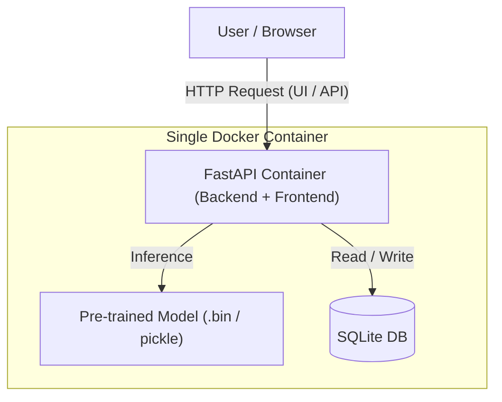

# HeadHunter Resume Salary & Career Analytics (ML Zoomcamp Capstone Project)

[](https://www.python.org/)
[](https://fastapi.tiangolo.com)
[](https://www.sqlite.org/)
[](https://www.docker.com/)
[](https://cloud.ru/)

End-to-end Machine Learning web application that predicts expected salary expectations based on applicant profiles (age, gender, education, experience, city, and desired job characteristics) extracted from HeadHunter resume datasets. 

The application integrates a **FastAPI backend and frontend interface into a single container**, stores application logs/feedback in **SQLite**, and is fully automated via CI/CD pipelines deploying into a Kubernetes cluster.

Built as a capstone project for the **[DataTalks.Club Machine Learning Zoomcamp](https://github.com/DataTalksClub/machine-learning-zoomcamp)**.

---

## Problem Description

Recruiters and job seekers often struggle to benchmark expected compensation accurately against market realities based on comprehensive criteria like experience duration, geographic location, and professional background.

**The Solution:**
This project provides an automated machine learning prediction service that:
1. Cleans and processes raw tabular resume profiles through an automated feature engineering pipeline.
2. Trains, tunes, and evaluates multiple regression models (Linear, Tree-based, and Boosting algorithms) to predict desired salary (`ЗП (руб)`).
3. Serves predictions and application data through an integrated web interface and REST API powered by **FastAPI**.
4. Persists application interaction history and logs locally via **SQLite**.
5. Runs inside a containerized environment deployed via GitHub Actions to a Managed Kubernetes cluster.

---

## System Architecture



## Tech Stack & Tools

- **Machine Learning**: Scikit-Learn, XGBoost / CatBoost, Pandas, NumPy.
- **Backend & Frontend**: FastAPI, Uvicorn, Jinja2 / HTML templates (served from one container).
- **Database**: SQLite (lightweight embedded relational storage).
- **Containerization**: Docker (multi-stage production builds with pre-baked model artifacts).
- **CI/CD & Deployment**: GitHub Actions (GHA), Kubernetes (`kubectl`), Cloud.ru infrastructure.

---

## Repository Structure

```
.
├── app/
│   ├── main.py              # FastAPI application & endpoints (/predict, /health)
│   └── templates/           # Frontend HTML UI templates
├── data/                    # Raw dataset and currency exchange rates
├── model/                   # Trained model artifacts (.bin / pickle)
├── notebooks/               # Jupyter notebook with EDA, data prep, and model tuning
├── k8s/                     # Kubernetes manifests (Deployment, Service, Secrets)
├── .github/workflows/       # CI/CD pipeline configuration (deploy.yml)
├── Dockerfile               # Single-container build recipe for Backend + Frontend + Model
├── requirements.txt         # Python project dependencies
└── train.py                 # Script for training and saving the final model
```

---

## Quickstart & Setup Guide

### Prerequisites
- Python 3.12 & `uv` or `pip`
- Docker installed locally
- Kubernetes CLI (`kubectl`) configured (if deploying locally or to cloud)

### 1. Clone the repository:
```bash
git clone [https://github.com/petrakimovdocker/hh_resume_project.git](https://github.com/petrakimovdocker/hh_resume_project.git)
cd hh_resume_project
```

---

### 2. Install Dependencies:

```
pip install -r requirements.txt
```

--- 

### 3. Run Training Script (Generates Model Artifact):

```
python train.py
```

### 4. Run the Application Locally via Docker:

```
docker build -t hh_resume_app:latest .
docker run -it -p 8000:8000 hh_resume_app:latest
```

Open your browser at http://localhost:8000 to interact with the web interface.

---

## CI/CD Pipeline (GitHub Actions)

The project utilizes GitHub Actions for continuous integration and delivery. The pipeline consists of three sequential stages:
1. **Test**: Runs linters and unit tests via `pytest`.
2. **Build and Push**: Builds the Docker image (with the model pre-baked inside) and pushes it to Docker Hub (`petrakimovdocker/hh_resume_app`).
3. **Deploy**: Configures Kubernetes credentials, substitutes secrets, and applies manifests to the target K8s cluster.

---

## Evaluation Criteria Compliance Matrix

| Criteria | Points Claimed | Supporting Artifacts & Implementation Details |
| :--- | :---: | :--- |
| **Problem Description** | **2 / 2** | [README.md](README.md): Section *Problem Description* details target business value and prediction mechanics. |
| **EDA & Data Prep** | **2 / 2** | [notebook.ipynb](notebooks/notebook.ipynb): Comprehensive analysis of missing values, distributions, feature engineering (salary currency conversion, experience parsing, OHE). |
| **Model Training & Tuning** | **3 / 3** | [train.py](train.py) & [notebook.ipynb](notebooks/notebook.ipynb): Training multiple models (Linear Regression, Random Forest, Gradient Boosting) with hyperparameter tuning and cross-validation. |
| **Script Conversion** | **1 / 1** | [train.py](train.py): Clean extraction of training logic from the notebook into a reproducible python script. |
| **Reproducibility** | **2 / 2** | [requirements.txt](requirements.txt) & structured directories with clear step-by-step local execution instructions. |
| **Model Deployment** | **2 / 2** | [main.py](app/main.py): Functional FastAPI web service exposing prediction endpoints. |
| **Dependency Management** | **2 / 2** | [requirements.txt](requirements.txt) with locked/pinned versions and virtual environment documentation. |
| **Containerization** | **2 / 2** | [Dockerfile](Dockerfile): Production-ready container bundling backend, frontend, SQLite, and trained model artifacts. |
| **Cloud Deployment** | **2 / 2** | [.github/workflows/deploy.yml](.github/workflows/deploy.yml) & `k8s/`: Automated CI/CD pipeline deploying the containerized app into a Managed Kubernetes cluster. |